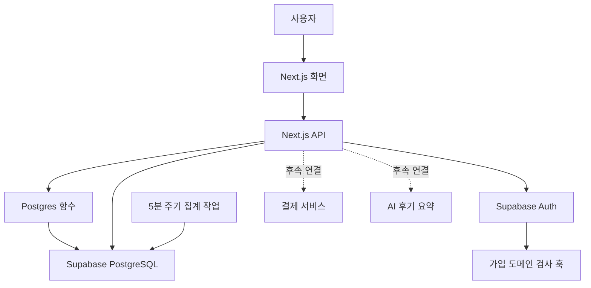

# 교냥픽 개발 계획

작성일: 2026-11-17 (검토 반영: 2026-11-17)

이 문서는 최종 기획안, HTML 화면 시안 6개, 젤리·리포트·강의평 이미지 시안을 바탕으로 실제 구현에 필요한 기술 스택, 데이터 구조, 개발 순서와 완료 기준을 정리한다. 기획안과 시안은 요구사항 자료로 참고했으며, 아래에서 사용자 확정 사항과 개발 제안을 구분한다.

현재 저장소에는 README와 이 문서만 있으며, 제공된 HTML은 예시 데이터와 화면 내부 상태로 동작하는 프로토타입이다. 화면 구조와 CSS는 활용하되 로그인, 데이터 저장, 추천, 지망 집계, 젤리 처리는 실제 서비스 코드로 구현한다.

개발 방향은 **Next.js + TypeScript + Supabase + Vercel로 웹서비스를 먼저 만들고, 22일 동안 테스트 젤리로 전체 이용 흐름을 완성하는 것**이다. **예산은 0원**이므로 모든 서비스는 무료 플랜 안에서 운영한다. 실제 결제와 AI 요약은 핵심 흐름이 안정되고 비용 계획이 생긴 다음에 붙인다.

## 1. 사용자 확정 사항

다음 내용은 2026-11-17 사용자 확인을 반영한 요구사항이다. 이전 개발 제안이나 기획안과 다를 경우 이 기준을 따른다.

| 항목 | 확정 내용 |
| --- | --- |
| 서비스 명칭 | **교냥픽**으로 통일한다. |
| 예산 | **0원.** 유료 플랜, 유료 도메인, 유료 메일 서비스를 쓰지 않는다. |
| 시간 선택 | **HTML 시안의 가능 시간 선택 방식**을 따른다. 선택하지 않은 시간에는 수업을 배치하지 않는다. |
| 첫 지망 등록 | **사용자·학기별 첫 지망 저장은 무료**다. |
| 지망 변경 | 이후 **변경해 저장할 때마다 젤리 1개**를 차감한다. 과목과 순위를 함께 바꿔도 1개만 차감한다. |
| 리포트 열람 | **최초 열람 시 젤리 1개를 차감하고, 재열람은 무료**다. |
| 지망 해제 후 재열람 | 한 번 열람한 리포트는 **해당 강좌를 지망에서 빼도 계속 무료로 다시 볼 수 있다.** |
| 집계 시점 | 평소 60분·수강신청 3일 전 30분·하루 전 10분·당일 5분 주기로 공개 통계를 갱신한다. 지망 변경은 다음 갱신에 반영된다(5.2 참고). |
| 학교 이메일 | **한양 이메일 인증 방식**을 유지한다. |
| 국적 정보 | 내국인/외국인 구분에 그치지 않고 **특정 국적까지 국가 목록에서 선택**하도록 한다. |

자료에서 유지하는 기능 규칙은 다음과 같다.

- 결제 이력이 없는 이용자는 추천안 1개, 젤리를 충전한 이용자는 추천안 최대 3개를 이용한다. 첫 버전에서 "충전한 이용자"는 **테스트 충전 주문 기록이 1건 이상 있는 이용자**로 판단한다.
- 교양탐색에서는 모의 경쟁률을 표시하지 않는다.
- 즐겨찾기한 교양을 내 리포트의 1·2·3지망 후보로 사용한다.
- 리포트 **최초 열람**은 현재 저장된 지망에 있는 강좌만 가능하다. 열람 권한이 생긴 뒤에는 지망 여부와 관계없이 재열람할 수 있다.
- 강의평은 서로 다른 강좌 2개마다 젤리 1개를 지급한다.
- 모의수강신청 표본과 추천인 코드 보상은 각각 젤리 1개다.
- 충전 상품은 5,000원에 5개, 10,000원에 12개다. 첫 버전에서는 실제 결제 대신 테스트 젤리를 사용한다.
- 젤리에는 유효기간을 두지 않는다. 실제 환불 정책과 결제 취소 처리는 유료 전환 전에 별도로 확정한다.

신규 이용자의 기본 흐름은 다음과 같다. 가입 직후 잔액은 0개다.

> 첫 지망 저장(무료) → 모의수강신청 표본 제출(+1) → 리포트 최초 열람(−1) → 재열람(무료) → 강의평 2개(+1) → 지망 변경(−1)

## 2. 기술 스택과 무료 운영

### 2.1 기술 스택

| 영역 | 기술 | 적용 이유 |
| --- | --- | --- |
| 화면 | Next.js App Router + React | 기획안의 기술 방향을 유지하고 화면과 API를 한 프로젝트에서 관리한다. |
| 언어 | TypeScript | 과목·분반·지망·젤리 데이터 구조를 프론트와 서버에서 일치시킨다. |
| 스타일 | 기존 CSS + CSS Modules | 시안의 색상·간격·카드 스타일을 활용한다. |
| 서버 API | Next.js Route Handlers | 추천, 지망 저장, 리포트 열람을 처리한다. |
| 업무 처리 | Postgres 함수 + `supabase.rpc()` | 젤리 차감처럼 여러 단계를 한 트랜잭션으로 처리한다. Supabase SDK의 개별 요청은 하나의 트랜잭션으로 묶이지 않는다. |
| DB | Supabase PostgreSQL | 과목·강좌·사용자·후기 등 관계가 있는 데이터를 관리한다. |
| 인증 | Supabase Auth + Before User Created 훅 | 학교 이메일 가입·인증·로그인·비밀번호 재설정과 가입 도메인 제한을 구현한다. |
| 메일 발송 | Gmail SMTP(앱 비밀번호) | 무료로 인증 메일을 보낸다(2.2 참고). |
| 권한 | RLS + 함수 실행 권한 회수 | 다른 사용자의 지망·잔액·개인정보 접근과 브라우저에서의 직접 조작을 막는다. |
| 정기 집계 | Supabase Cron | 5분마다 실행되는 작업 하나로 공개 통계를 갱신한다. |
| 로컬 개발 | Supabase CLI(로컬 DB) | 마이그레이션과 동시성 테스트를 로컬 DB에서 실행한다. |
| 배포 | Vercel(Hobby) | Next.js를 별도 설정 없이 배포하고, PR마다 미리보기 주소를 만든다. |
| 검증 | Vitest + Playwright + GitHub Actions | 추천·젤리 규칙과 실제 사용자 흐름을 PR마다 검증한다. |
| 실제 결제 | 토스페이먼츠, 후속 단계 | 웹에서 충전 상품의 결제·취소를 처리한다. |

첫 버전에서는 별도 백엔드 프로젝트를 만들지 않는다. Next.js 안에 필요한 API를 구현하고, 잔액·지망·열람 권한·보상을 바꾸는 처리는 Postgres 함수로 만든다. 별도 ORM, 상태 관리 라이브러리, 추천용 머신러닝 모델은 추가하지 않는다.

- [Next.js Route Handlers 공식 문서](https://nextjs.org/docs/app/getting-started/route-handlers)
- [Vercel의 Next.js 배포 문서](https://vercel.com/docs/frameworks/full-stack/nextjs)
- [Supabase Auth 공식 문서](https://supabase.com/docs/guides/auth)
- [Supabase RLS 공식 문서](https://supabase.com/docs/guides/database/postgres/row-level-security)
- [Supabase DB 함수 공식 문서](https://supabase.com/docs/guides/database/functions)

### 2.2 무료 운영 기준

| 항목 | 선택 | 제약과 대응 |
| --- | --- | --- |
| 도메인 | Vercel 기본 주소(`*.vercel.app`) | 유료 도메인을 사지 않는다. |
| 호스팅 | Vercel Hobby 플랜 | **개인·비상업적 용도만 허용**하므로 테스트 젤리로 운영하는 MVP까지만 사용한다(7.2 참고). 월 사용 한도는 1일차에 확인한다. 저장소가 공개 상태이므로 `.env`와 키는 절대 커밋하지 않는다. |
| DB·인증 | Supabase 무료 플랜 | 7일간 사용이 없으면 일시정지되고 자동 백업이 없다. 시연 전날 접속해 활성 상태를 확인하고, 주 1회 `supabase db dump`로 백업한다. 백업에는 개인정보가 있으므로 **git에 올리지 않고** 팀 비공개 저장소에 보관한다. |
| 인증 메일 | 팀 Gmail 계정 + 앱 비밀번호 | Supabase 기본 메일은 프로젝트 팀원 주소로만 발송하고 시간당 2통으로 제한되므로 반드시 커스텀 SMTP를 쓴다. Gmail은 하루 발송량 제한이 있어 시연·소규모 테스트용이다. 학교 메일함 도착과 스팸 분류를 3일차에 확인하고, 막히면 무료 발송 서비스로 바꾼다. |
| 결제·AI | 사용하지 않음 | 테스트 젤리로 대신하고, 비용이 생기는 기능은 7장 후속 단계로 둔다. |

## 3. 시스템 구조



화면은 입력과 결과 표시를 담당한다. API는 로그인·입력값을 검증하고 추천을 계산한다. 잔액·지망·열람 권한·보상을 바꾸는 처리는 Postgres 함수가 한 트랜잭션으로 수행하고, DB 제약이 중복과 음수 잔액을 막는다.

권한은 다음 세 가지로 지킨다.

1. **테이블:** 잔액·젤리 내역·열람 권한·보상 테이블에는 사용자용 INSERT·UPDATE·DELETE 정책을 두지 않는다. 사용자는 자기 행을 조회만 할 수 있다.
2. **함수:** Supabase는 public 스키마 함수를 anon을 포함한 모든 역할이 API로 호출할 수 있게 둔다. 첫 마이그레이션에서 기본 실행 권한을 회수하고, 필요한 함수에만 `authenticated` 실행 권한을 다시 준다.
   ```sql
   revoke execute on all functions in schema public from public, anon, authenticated;
   alter default privileges revoke execute on functions from public;
   alter default privileges in schema public revoke execute on functions from anon, authenticated;
   ```
3. **함수 내부:** 사용자 ID는 인자로 받지 않고 `auth.uid()`로 읽는다. `security definer` 함수에는 `set search_path = ''`를 지정한다. 테스트 젤리 지급처럼 관리자만 쓰는 함수는 `authenticated`에 실행 권한을 주지 않는다.

관리자용 비밀 키(service role)는 서버 환경 변수에만 두고 브라우저에 노출하지 않는다. 사용자별 데이터는 공용 캐시에 섞이지 않게 한다.

## 4. 화면과 데이터 설계

### 4.1 화면 연결

| 제공 자료 | 구현 화면 |
| --- | --- |
| Main.dc.html | 로그인 |
| Signup.dc.html | 학교 이메일 인증·기본 정보·약관 동의 |
| Home.dc.html | 서비스 소개·이용 안내·이동 배너 |
| Explore.dc.html | 가능 시간·학점·유형·선호 조건 입력 |
| ExploreResult.dc.html | 추천안·과목 검색·즐겨찾기 |
| MyReport.dc.html | 1·2·3지망 등록·변경·리포트 진입 |
| 젤리 이미지 | 잔액·충전 상품·사용 내역·무료 젤리 얻기 |
| 리포트 열람 전 팝업 이미지 | 최초 열람 차감 확인 |
| 리포트 팝업 이미지 | 경쟁률·강의평·성적·수업 정보 |
| 강의평 입력 이미지 | 학기·강좌 선택과 평가 입력 |

HTML의 `DCLogic`, `{{…}}`, `text/x-dc`는 시안용 실행 방식이므로 React 컴포넌트, 상태, API 호출로 바꾼다. 예시 과목 배열과 화면 내부 젤리 잔액도 DB 조회 결과로 교체한다.

상단 메뉴, 과목 카드, 버튼, 팝업은 공통 컴포넌트로 만든다. 공통 레이아웃과 기본 스타일을 먼저 맞추고 모바일 화면도 함께 확인한다.

내 리포트 화면의 저장 버튼은 첫 저장이면 "무료로 저장", 이후에는 "젤리 1개로 변경"으로 표시한다. 최초 열람 팝업은 젤리 1개 차감을 안내하고, 이미 열람한 리포트는 "다시 보기(무료)"로 표시한다. 지망에서 뺀 강좌도 열람 권한이 있으면 "열람한 리포트" 목록에서 다시 볼 수 있게 한다.

### 4.2 데이터 구조

**과목과 개설 강좌를 분리한다.** 같은 과목이라도 학기·교수·분반이 다르면 별도의 개설 강좌다. 후기, 시간표, 정원, 지망은 개설 강좌에 연결한다.

| 데이터 묶음 | 주요 내용 |
| --- | --- |
| 사용자·동의 | 인증 사용자 ID, 학년, 학과, 국적 코드, 유학생 여부, 약관 버전·동의 시각 |
| 과목·교수·개설 강좌 | 과목 코드, 학기, 교수, 분반, 학점, 강좌 유형, 정원, 수강 제한, 예시 데이터 여부·출처 |
| 강좌 시간 | 개설 강좌별 요일·시작·종료 시각. 주 2회 수업은 시간 2개 저장 |
| 학사 일정 | 학기별 수강신청 시작 시각(`timestamptz`) |
| 즐겨찾기 | 사용자별 즐겨찾기 강좌 |
| 지망 묶음 | 사용자·학기별 1행(유일). 1·2·3지망 강좌, 수정 버전, 최초 저장 시각. 첫 저장 이후 삭제하지 않는다. |
| 모의지원 표본 | 사용자·학기별 1행(유일). 1·2·3지망 응답 |
| 강의평·신고 | 만족도·성적 구간·과제·팀플·시험·출석·한 줄 평, 숨김 상태. 사용자·개설 강좌별 1개(유일) |
| 젤리 지갑 | 사용자별 잔액. `CHECK (balance >= 0)` |
| 젤리 내역 | 변동량, 사유, 관련 대상, 요청 식별값(`UNIQUE`) |
| 테스트 주문 | 상품, 젤리 수, 테스트 여부, 생성 시각. 추천안 3개 해금 판단에 사용 |
| 열람 권한 | 사용자·개설 강좌별 1행(유일), 최초 열람 시각 |
| 공개 통계 | 강좌별 1지망 인원, 정원, 경쟁률, 표본 수, 강의평 집계, 갱신 시각 |
| 집계 작업 상태 | 마지막 실행·성공 시각, 결과, 오류 내용 |

국적은 국가 목록에서 선택하고 ISO 3166-1 alpha-2 국가 코드로 저장한다. 국적과 유학생 여부는 같은 개념으로 취급하지 않으며, 실제 수강 제한에 필요한 정보를 구분한다. 학번은 수집하지 않는다.

**젤리 지갑과 내역은 같은 함수 안에서 함께 바꾼다.** 잔액만 바꾸거나 내역만 쓰는 경로는 두지 않는다. 테스트에서 "잔액 = 내역 합계"를 확인한다.

**열람 권한은 사용자·개설 강좌 단위로 영구히 유지한다.** 같은 강좌의 리포트는 순위가 바뀌거나, 지망에서 빠지거나, 통계가 갱신되어도 추가 차감하지 않는다. 다른 학기·교수·분반의 강좌는 별도 리포트로 취급한다.

## 5. 단계별 개발 순서

화면 작업과 DB 작업은 서로 의존하지 않으므로 1일차부터 병렬로 진행한다.

| 일차 | 프론트엔드(한지석) | 백엔드·DB(윤정재) | 기획·검수·QA(이진규·이성준) |
| --- | --- | --- | --- |
| 1~2 | 프로젝트 생성, Vercel 첫 배포, 공통 레이아웃·컴포넌트 | Supabase 프로젝트, 로컬 DB, 권한 회수 마이그레이션 | 남은 정책 확정(Step 1) |
| 3~4 | 시안 6개 화면 정적 변환 | 테이블·RLS·가입 훅·SMTP·예시 데이터 | 예시 강좌 20~30개 입력 |
| 5~7 | 화면에 API 연결 | 추천 조합 탐색 | 추천 테스트 사례 작성 |
| 8~11 | 지망·젤리·리포트 화면 | 지망·열람 함수와 동시성 테스트 | 젤리 시나리오 점검 |
| 12~15 | 리포트 상세 화면 | 공개 통계 집계 작업 | 집계 수치 대조 |
| 16~18 | 강의평·신고·운영 화면 | 보상·신고 처리 | 강의평 테스트 데이터 |
| 19~22 | 통합 검증·시연 준비 | 통합 검증·백업 점검 | 전체 흐름 QA |

### Step 1. 프로젝트 기반과 남은 정책 확정 — 1~2일차

1일차에 Next.js 프로젝트를 만들고 Vercel에 GitHub 저장소를 연결해 첫 배포를 한다. GitHub Actions에서 PR마다 타입 검사와 Vitest를 실행한다. 배포 문제를 마지막 주가 아니라 첫 주에 발견하기 위해서다.

첫 마이그레이션에서 함수 실행 권한을 회수한다(3장). 이후 함수는 만들 때마다 필요한 역할에만 실행 권한을 준다.

남은 정책은 다음과 같다.

- 학년·학과·국적·P/F 수강 제한을 어떤 데이터로 검사할지 정한다.
- 학년별 정원이 있는 강좌의 집계 대상과 정원 기준을 정한다.
- 표본 부족 기준을 정한다. 기본값으로 **1지망 인원 5명 미만이면 경쟁률 숫자 대신 "표본 부족"**을 표시하고, 추천의 안정·도전 분류에는 **강좌별 1지망 인원 5명 이상**을 요구한다. 기획안의 30명 예시는 공개 운영 단계에서 다시 검토한다.
- 강의평 중복 제한은 **사용자·개설 강좌 단위**(개설 강좌에 학기가 포함됨)로 한다.
- API 요청·응답 형식과 오류 코드를 정한다.

학사 규칙은 기획안의 요구사항으로 구현하되, 공개 전에 적용 학기의 공식 안내를 다시 확인한다.

**완료 기준:** Vercel 주소에서 빈 화면이 열리고, PR에서 검사가 실행되며, 남은 정책이 이 문서에 반영된다.

### Step 2. DB·인증·예시 데이터 구축 — 3~4일차

4.2의 테이블과 제약, RLS를 마이그레이션으로 만든다. 기획안에 있는 20~30개 예시 강좌를 같은 형식으로 입력하고, 이전 학기 후기 작성에 필요한 강좌도 준비한다. 데이터에는 출처와 예시 데이터 여부를 남긴다.

**인증 메일:** Supabase 기본 메일은 팀원 주소에만 발송되므로 이 단계에서 Gmail SMTP를 설정한다. Supabase의 메일 발송 한도(커스텀 SMTP 기본 시간당 30통)도 테스트 규모에 맞게 확인한다. 팀원이 아닌 한양 메일 주소로 가입해 인증 메일이 실제로 도착하는지, 스팸함으로 가지 않는지 확인한다. [Supabase 이메일 설정 문서](https://supabase.com/docs/guides/auth/auth-smtp)

**가입 도메인 제한:** 브라우저에서 `signUp`을 직접 호출하면 서버 검사를 거치지 않고 계정이 만들어진다. 그래서 다음 순서로 막는다.

1. **Before User Created 훅**(무료 플랜 사용 가능)을 Postgres 함수로 등록해, 이메일 도메인이 허용 목록(`hanyang.ac.kr`)에 없으면 가입을 거부한다. 허용 도메인은 이 함수 한 곳에서만 관리한다.
2. 훅에서 도메인 거부가 기대대로 동작하지 않으면, Supabase의 공개 가입을 끄고 Next.js 가입 API가 서버에서 도메인을 검사한 뒤 관리자 API로 계정을 만든다.
3. 어느 방식이든 프로필 생성 시 서버에서 도메인을 한 번 더 확인한다.

1번이 동작하는지 3일차에 gmail 주소로 가입을 시도해 확인한다. [Supabase Auth Hooks 문서](https://supabase.com/docs/guides/auth/auth-hooks)

학교 메일 소유 확인과 사람 단위 중복 가입 차단은 다르므로, 이메일만으로 완전한 1인 1계정이 보장된다고 가정하지 않는다.

**완료 기준:** 한양 메일로 가입·인증·로그인이 되고 gmail 가입은 거부된다. 기본 정보와 즐겨찾기가 새로고침해도 유지되고, 다른 사용자의 데이터는 조회할 수 없으며, 브라우저에서 anon 키로 잔액을 바꾸거나 관리자 함수를 호출할 수 없다.

### Step 3. 화면 연결과 추천 구현 — 5~7일차

로그인 → 가입 → 홈 → 교양탐색 → 추천 결과 순서로 화면을 연결한다. 추천은 AI 모델 대신 검증 가능한 규칙으로 구현한다.

추천 처리 순서는 다음과 같다.

1. 학년·학과·국적·기타 수강 제한에 맞는 강좌를 남긴다.
2. 선택한 가능 시간 안에 들어오는 강좌를 남긴다. SMART의 오프라인·실시간 수업도 검사한다.
3. 강좌끼리 시간 충돌, 학점 범위, e-러닝 개수 제한을 검사하며 조합을 만든다.
4. 과제 부담, 팀플, 오전·오후 선호에 따라 조합 점수를 계산한다.
5. 무료 이용자에게 1개, 충전 이용자에게 최대 3개의 유효한 추천안을 반환한다.

정해진 수업 시간이 없는 e-러닝은 시간 충돌 검사에서 제외하되, 유형별·유학생별 개수 제한은 적용한다. 대면 및 SMART 강좌의 모든 수업 시간이 가능한지 확인한다.

과목을 점수순으로 몇 개 뽑는 것만으로는 과목끼리의 시간 충돌을 막을 수 없다. 초기 데이터 규모에서는 조합을 탐색하면서 시간 충돌이나 최대 학점 초과가 발생한 가지를 중단하는 방식으로 시작한다. 강좌 수가 늘면 응답 시간을 측정하고 탐색 범위를 조정한다.

**추천안 구성.** 표본이 충분할 때와 부족할 때를 나눈다. 표본 기준은 Step 1의 "강좌별 1지망 인원 5명 이상"이다.

| 추천안 | 표본이 충분할 때 | 표본이 부족할 때 |
| --- | --- | --- |
| 1번 | **소신**: 선호 점수가 가장 높은 조합 | **추천 1**: 선호 점수 1위 조합 |
| 2번 | **안정**: 모든 강좌가 표본 기준을 넘고 경쟁 부담이 낮은 조합 | **추천 2**: 선호 점수 2위 조합 |
| 3번 | **도전**: 경쟁 부담이 높은 강좌를 포함한 조합 | **추천 3**: 선호 점수 3위 조합 |

- 표본이 부족한 경우에도 충전 이용자는 서로 다른 조합을 최대 3개 받는다. 각 추천안은 앞선 추천안과 **강좌가 1개 이상 달라야** 한다.
- 표본이 부족한 추천안에는 "아직 모의지원 표본이 적어 안정·도전 분류를 보류했어요"라고 표시하고, 표본이 충분해지면 자동으로 안정·도전 분류를 적용한다.
- 표본이 없는 강좌를 경쟁 부담이 낮다고 판단하지 않는다.
- 조건에 맞는 조합이 3개보다 적으면 있는 만큼만 보여주고, 시간·학점 조건을 넓히면 더 많은 추천을 받을 수 있다고 안내한다. 존재하지 않는 추천안을 만들어 채우지 않는다.
- 조건에 맞는 조합이 없으면 제한을 몰래 완화하지 않고 시간·학점 변경을 안내한다.

추천 이유는 "오후 선호와 일치", "팀플 없음"처럼 계산에 실제 사용한 조건으로 생성한다. 교양탐색 응답에는 리포트용 경쟁률 수치를 노출하지 않는다.

**완료 기준:** 추천 조합이 시간·학점·수강 제한을 모두 통과하고, 표본이 없는 상태에서도 충전 이용자가 서로 다른 조합 3개(조합이 충분한 경우)를 받으며, 즐겨찾기가 내 리포트로 연결된다.

### Step 4. 지망 저장·젤리·리포트 열람 구현 — 8~11일차

**지망 저장**은 Postgres 함수 하나(`save_wishlist`)로 처리하고 `supabase.rpc()`로 호출한다.

> 로그인 확인 → 강좌·순위·수정 버전 검증 → 지망 묶음이 없으면 무료로 생성 / 있으면 젤리 1개 차감 + 내역 기록 + 지망 갱신

- 차감은 `update ... set balance = balance - 1 where user_id = auth.uid() and balance >= 1` 한 문장으로 처리하고, 바뀐 행이 없으면 잔액 부족 오류를 반환한다. 이 방식이면 여러 탭에서 동시에 요청해도 잔액이 음수가 되지 않는다.
- 첫 저장 여부는 지망 묶음 행의 존재로 판단한다. 사용자·학기 유일 제약이 있으므로 동시 첫 저장 요청이 와도 무료 저장은 한 번만 된다.
- 지망 묶음은 지망을 모두 비워도 삭제하지 않는다. 비웠다가 다시 저장해도 첫 저장 무료가 반복되지 않는다.
- 같은 강좌를 여러 순위에 중복 등록하지 못하게 한다. 잔액이 부족하면 지망도 변경하지 않는다.
- 변경 없는 저장은 화면에서 비활성화하고, 서버에서도 차감 없이 그대로 반환한다.
- 요청 식별값은 젤리 내역의 `UNIQUE` 제약으로 처리한다. 같은 요청이 다시 오면 차감하지 않고 처음 결과를 반환한다.
- 집계는 이 함수에서 갱신하지 않는다(Step 5).

**리포트 열람**은 다음 기준을 따른다.

1. 열람 권한이 이미 있으면 **지망 여부와 관계없이** 젤리를 차감하지 않고 리포트를 반환한다.
2. 열람 권한이 없으면 해당 강좌가 현재 저장된 지망에 있는지 검사한다. 없으면 열람할 수 없다.
3. 최초 열람이면 확인 팝업에서 젤리 1개 차감을 안내한다.
4. 확인 요청은 함수 하나(`open_report`)에서 잔액 차감, 내역 기록, 열람 권한 생성을 한 트랜잭션으로 처리한다.
5. 열람 권한의 사용자·개설 강좌 유일 제약으로 동시 최초 열람 요청에도 한 번만 차감한다.

젤리 차감은 POST 요청으로만 일어나게 한다. 단순 페이지 조회나 브라우저의 미리 불러오기로는 차감되지 않는다. 리포트 본문 조회에도 열람 권한 검사를 적용한다.

**테스트 충전**은 관리자만 호출할 수 있는 함수로 테스트 주문을 만들고 젤리를 지급한다. 시연 계정에는 운영자가 지급한다.

동시성 테스트는 로컬 Supabase에서 같은 요청을 동시에 여러 번 보내 확인한다.

**완료 기준:** 첫 지망 저장은 무료이고 이후 변경마다 1개가 차감된다. 잔액과 내역 합계가 일치하고, 중복·동시 요청으로 이중 차감되지 않는다. 같은 리포트는 잔액이 0개여도, 지망에서 뺀 뒤에도 무료로 다시 볼 수 있다.

### Step 5. 모의 경쟁률·리포트 연결 — 12~15일차

#### 5.1 계산식

> 모의 경쟁률 = 해당 강좌의 유효한 1지망 인원 ÷ 해당 정원 × 100

시안 예시는 `64명 ÷ 20명 × 100 = 320%`다. 정원이 없거나 0이면 계산하지 않는다. 학년별 정원을 적용한다면 분자도 같은 학년 집단으로 맞춘다.

표본 응답과 내 리포트 지망을 별도 참가자로 더하면 같은 사용자가 중복 집계된다. 사용자·학기별로 **저장된 지망이 있으면 지망을, 없으면 표본 응답을** 한 번만 센다. 참여자 수와 강좌별 지망 인원도 구분한다.

#### 5.2 집계 방식

**공개 통계는 갱신할 때마다 원본 테이블에서 다시 계산한다.** 지망 저장 때마다 집계 숫자를 증감하는 방식은 쓰지 않는다. 사용자에게 보이는 값은 공개 통계뿐이므로 즉시 반영해도 차이가 보이지 않고, 증감 방식은 실제 값과 어긋날 위험만 생긴다. 초기 데이터 규모에서는 `group by` 한 번으로 충분하다. 지망 변경은 다음 공개 통계 갱신에 반영된다.

**정기 작업은 Supabase Cron 작업 하나로 처리한다.** 5분마다 실행되고, 현재 구간의 주기가 지나지 않았으면 바로 종료한다.

| 수강신청까지 남은 시간 | 공개 통계 갱신 주기 |
| --- | --- |
| 3일 초과 | 60분 |
| 3일 이내 | 30분 |
| 하루 전 | 10분 |
| 당일 | 5분 |

- pg_cron은 UTC 기준으로 실행된다. 수강신청 시작 시각은 `timestamptz`로 저장하고, "하루 전"과 "당일"은 서울 시간(`Asia/Seoul`) 날짜로 판단한다.
- 실패하면 마지막 성공 결과를 유지하고, 집계 작업 상태에 실패 시각과 오류를 남긴다.
- 화면에는 실제 집계 완료 시각을 표시한다.

[Supabase Cron 공식 문서](https://supabase.com/docs/guides/cron)

#### 5.3 리포트 표시 원칙

- 모의 경쟁률은 실제 경쟁률과 구분하고 표본 수·갱신 시각을 함께 표시한다.
- 1지망 인원이 표본 부족 기준(5명 미만)이면 숫자 대신 "표본 부족"을 표시한다.
- 강의평·성적 비율에는 사용자 자기신고 데이터라는 출처와 응답 수를 표시한다.
- P/F 응답은 A·B·C 성적 비율 계산에서 제외한다.
- 숨김 처리된 후기는 집계와 노출에서 제외한다.
- 교수의 다른 과목이나 영역 평균을 썼다면 "보완값"으로 구분한다.
- 데이터가 없으면 "데이터 없음"을 표시한다.

담당 교수 과거 데이터와 보완값 생성은 후속 단계로 미룬다. 시연용 수치를 사용하는 부분은 예시임을 표시하고, 실제 데이터와 구분한다.

**완료 기준:** DB 집계와 화면 수치가 일치하고 표본 부족·정원 없음·후기 없음에서도 정상 동작한다. 지망 변경 후 다음 갱신에서 중복 없이 반영되고, 구간 경계에서 주기가 바뀐다.

### Step 6. 강의평·무료 젤리·운영 기능 구현 — 16~18일차

강의평은 학기 → 과목 → 교수 → 분반을 선택하도록 한다. 서버에서는 선택 조합이 실제 개설 강좌인지 검증한다. 만족도, 성적 구간, 과제, 팀플, 시험 횟수, 출석 방식, 한 줄 강의평을 저장한다.

강의평 보상은 숨겨지지 않은 서로 다른 강좌 2개마다 젤리 1개를 지급한다. 강의평 저장과 보상 지급은 함수 하나에서 처리하고, 강의평의 사용자·개설 강좌 유일 제약으로 중복 제출을 막는다. 모의수강신청 표본은 사용자·학기별 최초 제출 시 한 번만 보상한다.

신고 접수 시 자료대로 후기를 임시 숨김 처리하고 운영자가 검토한다. 최소 운영 화면에는 신고 목록과 숨김·복구 기능을 포함한다. 신고만으로 이미 지급한 보상을 즉시 회수하지 않으며, 허위 작성 확정 시 회수 방식은 별도 정책으로 정한다. 숨김 상태의 후기는 새 보상 산정과 통계에서 제외한다.

추천인 코드 지급 자동화는 후속 단계로 진행한다. 사용자당 지급 횟수, 자기추천, 중복 계정 악용 방지 기준을 먼저 정한다.

**완료 기준:** 강의평 2개당 정확히 한 번 보상하고, 중복 제출로 추가 지급되지 않으며, 숨겨진 후기가 리포트에도 노출되지 않는다.

### Step 7. 통합 검증·배포 — 19~22일차

다음 흐름을 실제 브라우저에서 끝까지 검증한다.

> 가입 → 가능 시간·조건 입력 → 추천 → 즐겨찾기 → 첫 지망 저장(무료) → 표본 제출(+1) → 리포트 최초 열람(−1) → 무료 재열람 → 강의평 2개(+1) → 지망 변경(−1) → 지망에서 뺀 강좌 리포트 재열람(무료)

| 대상 | 필수 검증 사례 |
| --- | --- |
| 추천 | 시간 충돌, e-러닝 제한, 국적 제한, 학점 미달·초과, 가능한 조합 없음, 표본 없음 상태의 충전 이용자 3개 |
| 지망 | 첫 저장 무료, 동시 첫 저장, 비운 뒤 재저장, 변경 시 차감, 변경 없는 저장 |
| 젤리 | 잔액 부족, 동시 요청, 중복 클릭, 실패 후 재시도, 잔액 = 내역 합계 |
| 리포트 | 최초 열람 1개 차감, 재열람 무료, 잔액 0개 재열람, 지망 해제 후 재열람, 지망에 없는 강좌 최초 열람 거부 |
| 집계 | 표본·저장 지망 중복, 지망 변경, 정원 없음, 집계 주기 경계, 집계 실패 시 이전 결과 유지 |
| 권한 | 다른 사용자 지망·잔액 접근, 열람 권한 없는 리포트 접근, 브라우저에서 잔액 직접 수정, 관리자 함수 호출, 한양 외 도메인 가입 |
| 보상 | 같은 강좌 재입력, 강의평 동시 제출, 표본 중복 제출 |
| 화면 | 모바일, 빈 목록, 로딩·오류 안내, 키보드로 팝업 조작 |

개발·시연 데이터와 실제 사용자 데이터는 분리한다. Vercel 미리보기에서 검토한 뒤 배포한다. 공개 전에 `supabase db dump` 백업에서 로컬 DB로 복구해 보고, 집계 실패 확인 방법과 API 오류 로그를 점검한다. 시연 전날 Supabase 프로젝트가 일시정지되지 않았는지 확인한다.

22일은 개발 2명이 지속적으로 참여하고 데이터·정책이 제때 전달되는 시연용 MVP 일정이다. 실제 결제와 공개 운영 준비까지 포함한 확정 일정으로 보지 않는다. 마지막 2일은 통합 오류 수정과 시연 준비를 위한 예비일로 확보한다.

**완료 기준:** 핵심 흐름의 자동 검증과 수동 점검을 통과하고, 별도 설명 없이 시연 계정으로 전체 기능을 사용할 수 있다.

## 6. 팀 역할과 협업

개발은 한지석(프론트엔드)과 윤정재(백엔드) 두 명이 맡는다(2026-11-19 변경). 단계별 병렬 작업은 5장 첫 표를, 남은 작업의 세부 분담은 [작업 분담](work-split.md)을 따른다.

| 담당 | 주 업무 |
| --- | --- |
| 이진규 | 화면·문구·시안 검수, 발표 자료 |
| 이성준 | 과목 데이터, 정책·약관 검토, 테스트 시나리오, QA |
| 한지석 | 프론트엔드: 화면 구현, 시안 반영, 브라우저 E2E 테스트 |
| 윤정재 | 백엔드: Supabase 연동, DB, 추천, 지망 집계, 젤리·보상, API, 인증, 배포, 후속 AI 연동 |

각 단계 시작 전에 기능 설명, 화면, 예시 데이터, 완료 기준을 전달한다. 개발은 미리보기 링크와 변경 요약을 공유하고 기획은 테스트 결과를 이슈로 기록한다. DB 변경은 마이그레이션으로 관리하고, 작업 브랜치에서 PR 검사를 통과한 뒤 main에 합친다.

AI로 화면 코드를 작성하더라도 인증·권한·젤리·보상 관련 코드와 마이그레이션은 개발 담당자가 검토한다. 새 함수를 추가할 때는 실행 권한을 누구에게 주었는지 PR에 적는다.

## 7. 첫 버전 이후 확장 순서

### 7.1 공개 운영 준비와 실제 데이터 확대

학교 이메일 인증의 도달률, 강좌 정보 정확도, 신고 대응, 개인정보 보관·삭제 절차를 검증한다. 표본과 강의평이 없는 항목을 임의 수치로 채우지 않는다. 학사 규칙은 매 학기 확인한다.

이용자가 늘어 Gmail 발송 한도나 무료 플랜 한도에 가까워지면 메일 서비스와 플랜 변경 비용을 그때 다시 검토한다.

외부 강의평·학교 자료는 이용 조건과 사용 권한을 확인한 범위에서만 활용한다. 허락되지 않은 자동 수집이나 학교 로그인 정보 수집을 전제로 구현하지 않는다.

### 7.2 실제 결제

**실제 결제를 붙이기 전에 호스팅을 바꾼다.** Vercel Hobby 플랜은 상업적 이용을 허용하지 않으므로 Vercel Pro로 올리거나, 상업적 이용이 가능한 무료 호스팅(Netlify 등)으로 옮긴다. 코드는 그대로 두고 환경 변수와 주소만 옮기면 된다.

서버에서 상품·금액을 정하고 주문을 저장한다. 결제 결과 검증·승인 후 젤리 지급과 추천안 해금 처리를 수행한다. 같은 결제는 한 번만 반영한다.

승인 후 DB 기록 실패에 대한 재처리, 결제 취소, 유료·무료 젤리 구분, 사용 순서, 환불과 해금 권한의 관계도 함께 구현한다. 환불 문구와 실제 정책은 유료 전환 전에 확인한다. 테스트 젤리 지급과 테스트 해금 기능은 운영 환경에서 일반 사용자가 호출할 수 없게 한다.

토스페이먼츠 공식 연동도 성공 화면으로 전달된 결제 정보를 서버에서 검증하고 승인하도록 안내한다. [토스페이먼츠 결제 연동 문서](https://docs.tosspayments.com/guides/v2/payment-widget/integration)

### 7.3 AI 후기 요약과 지망 설명

LLM API는 사용량에 따라 비용이 생기므로 예산이 생긴 뒤 진행한다. 후기가 쌓인 뒤 익명 후기 요약과 지망 변경 설명에 적용하고, 한국어 요약 품질, 비용, 응답 시간을 샘플로 비교해 모델을 선택한다.

개인정보를 제거한 텍스트만 전송하고 요약 결과를 저장해 재사용한다. 숨김·삭제된 후기가 포함된 요약은 무효화하고 갱신한다. AI가 실패해도 리포트 수치와 원래 정보는 제공한다.

시간 충돌, 수강 제한, 경쟁률 계산, 젤리 차감은 코드와 DB가 판단한다. AI에는 집계 근거에 없는 성공 확률이나 추천 이유를 만들게 하지 않는다.

## 8. 범위와 확인하지 않은 사항

이 문서는 개발 계획이며 구현·배포·성능 측정을 완료했다는 의미가 아니다. 첫 출시 범위에서는 실제 결제, AI 요약, 외부 자료 자동 수집, LMS 연동, 빈자리 알림, 타 대학 확장을 제외한다.

주요 위험은 초기 표본 부족, 강좌 데이터 정확도, 학교 메일의 Gmail 발송 메일 수신(스팸 분류), 젤리·보상 동시성 처리, 무료 플랜 한도다.

구현 초기에 직접 확인해야 하는 사항은 다음과 같다.

- Before User Created 훅으로 이메일 도메인별 가입 거부가 가능한지(3일차). 안 되면 Step 2의 대안을 쓴다.
- 한양 메일이 Gmail SMTP 발송 메일을 받는지(3일차).
- Vercel Hobby 플랜의 현재 월 한도와, 팀원 커밋이 막힘 없이 배포되는지(1일차). 막히면 GitHub Actions에서 Vercel CLI로 배포한다.

기획안의 환불 문구, 외부 자료 이용 조건, 적용 학기의 학사 규칙은 공개 전에 별도 확인해야 한다.
