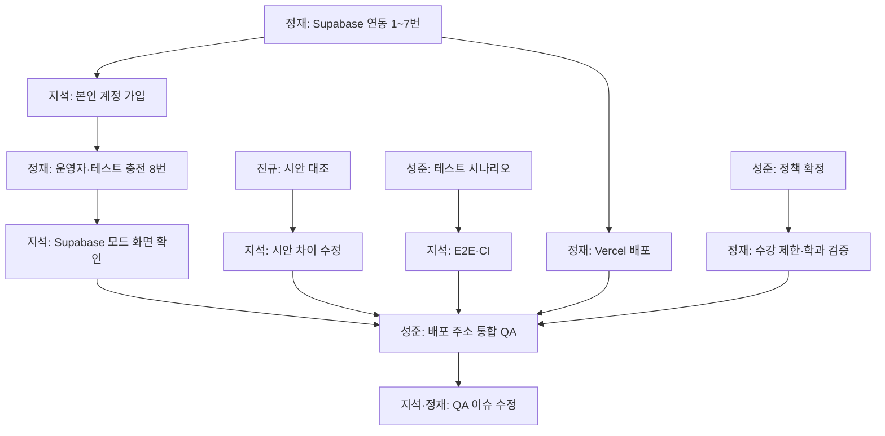

# 교냥픽 작업 분담

작성일: 2026-11-19

1차 MVP(`2215fbc`)의 코드는 대부분 들어와 있다. 남은 일을 **백엔드·Supabase(윤정재)**와 **프론트엔드(한지석)**로 나눈다. 정책과 단계별 기준은 [개발 계획](development-plan.md)을 따르고, 설정 절차는 [README](../README.md)의 "Supabase 연결"을 따른다.

개발 외 역할은 개발 계획 6장대로다. **이진규**는 화면·문구·시안 검수와 발표 자료를, **이성준**은 과목 데이터, 정책·약관 검토, 테스트 시나리오, QA를 맡는다. 시안 검수 결과와 테스트 시나리오는 이슈로 받아 각 개발자가 반영한다.

## 1. 경계

| 구분 | 백엔드·Supabase (윤정재) | 프론트엔드 (한지석) |
| --- | --- | --- |
| 담당 파일 | `supabase/`, `src/lib/server.ts`, `src/lib/domain.ts`, `src/lib/recommend.ts`, `src/app/api/**`, `src/app/auth/**`, `scripts/`, `tests/database.test.ts` | `src/components/**`, `src/app/globals.css`, `src/app/layout.tsx`, `src/app/[[...path]]/`, 브라우저 E2E 테스트 |
| 같이 보는 파일 | `src/lib/types.ts`, `src/lib/catalog.ts` | 같음 |

- **같이 보는 파일을 바꿀 때는 먼저 상대에게 알린다.** API 응답 형식이 여기서 정해진다.
- 각자 작업 브랜치에서 PR을 열고, 상대가 확인한 뒤 `main`에 합친다.
- 프론트엔드는 Supabase 없이 **로컬 시연 모드**로 바로 작업할 수 있다. `.env.local`의 Supabase 값을 비우고 `npm run dev`를 실행한 뒤 "가입 없이 시연 시작하기"를 누른다.

## 2. API 약속

프론트엔드는 아래 API만 호출한다. 모든 POST는 같은 출처(`Origin`)에서만 받고, 실패하면 `{ error: string }`과 상태 코드를 돌려준다.

| API | 용도 | 응답 |
| --- | --- | --- |
| `GET /api/session` | 로그인 상태, 계정, 강좌 목록 | `Snapshot`, 로그인 전에는 `{ account: null, mode }` |
| `POST /api/auth` | `signup`, `signin`, `verify`, `reset`, `password`, `logout`, `demo` | `{ ok: true }` |
| `POST /api/recommend` | `Filters`로 추천 | `{ plans: Plan[] }` (경쟁률 수치 없음) |
| `POST /api/action` | `{ action: Mutation, requestId: uuid }` | 갱신된 `Snapshot` |
| `GET /api/report/[id]` | 열람 권한이 있는 리포트 | `Report` |
| `GET`·`POST /api/moderation` | 운영자 신고 목록, 숨김·복구 | `{ reviews }`, `{ ok: true }` |
| `GET /auth/callback` | 메일 인증·비밀번호 재설정 링크 | `/home` 또는 `/reset-password`로 이동 |

`Mutation`의 종류는 `favorite`, `save`, `sample`, `open`, `review`, `report`, `profile`이다. 타입은 `src/lib/types.ts`가 기준이다.

- **`requestId`는 버튼 클릭 한 번마다 새로 만들고, 재시도할 때는 같은 값을 다시 보낸다.** 서버는 같은 `requestId`를 한 번만 처리하므로 중복 차감을 막는 데 필요하다.
- 젤리 차감(`save` 변경, `open` 최초 열람)은 사용자가 확인한 뒤에만 보낸다.

## 3. 백엔드·Supabase — 윤정재

### 3.1 Supabase 연동 (가장 먼저)

1. Supabase 프로젝트 생성(무료 플랜, 서울 리전)
2. SQL Editor에서 `.local/supabase-setup.sql` 실행. 마이그레이션과 예시 강좌 24개가 한 트랜잭션으로 들어간다. 예시 강좌는 7장 순서대로 `202611240002_remove_example_courses.sql`로 지운다.
3. `.env.local`에 URL, publishable 키, service role 키 입력. **키는 커밋하거나 채팅에 붙여넣지 않는다.**
4. Authentication에서 이메일 확인 켜기, Gmail SMTP(앱 비밀번호) 설정
5. Before User Created 훅에 `public.before_user_created` 연결
6. Site URL과 Redirect URL에 `/auth/callback`, `/auth/callback?next=/reset-password` 등록
7. Cron 활성화 후 `supabase/cron.sql` 실행. 수강신청 일정을 실제 값으로 변경
8. 운영자 계정 등록(`operators`)과 시연 계정 테스트 충전(`grant_test_credit`)

**완료 기준:** gmail 가입은 거부되고 한양 메일 가입·인증·로그인이 된다. `/api/session`이 `mode: "supabase"`로 응답한다. 5분 뒤 `aggregation_status.last_success`가 갱신된다. 완료되면 프론트엔드에 알린다.

### 3.2 남은 백엔드 작업

- [x] 강의평 학기 검사: 지난 학기 강좌만 강의평을 받도록 수정하고 테스트 추가(2026-11-19 반영)
- [x] `profile` 수정 시 학과가 `DEPARTMENTS` 목록에 있는지 DB에서도 검사(2026-11-24 `profiles_department_check` 마이그레이션 및 테스트 추가)
- [ ] 실제 Supabase에서 동시 요청 확인: 같은 최초 열람을 여러 번 동시에 보내도 1개만 차감되는지
- [ ] Vercel 프로젝트 연결, 환경 변수 3개 등록, 배포 주소를 Supabase Redirect URL에 추가. Hobby 플랜에서 지석의 커밋도 막힘 없이 배포되는지 확인(막히면 GitHub Actions에서 Vercel CLI로 배포)
- [ ] 주 1회 `supabase db dump` 백업(개인정보가 있으므로 git 밖에 보관)
- [x] 실제 강좌 데이터를 넣기 전에 조합 탐색 제한(최대 30강좌)을 교체하고 응답 시간 측정(2026-11-24 비트마스크·제한 탐색 교체 및 300강좌 테스트 추가)

## 4. 프론트엔드 — 한지석

화면은 `src/components/app.tsx`의 `App` 하나가 경로별로 그린다. 경로는 `/login`, `/signup`, `/forgot-password`, `/reset-password`, `/home`, `/explore`, `/my-report`, `/jelly`, `/reviews`, `/admin`이다.

### 4.1 지금 바로 할 수 있는 작업 (시연 모드)

- [ ] 시안 6개(Main, Signup, Home, Explore, ExploreResult, MyReport)와 젤리·리포트·강의평 이미지 시안 대비 차이 수정. 대조와 검수는 이진규가 하고 결과를 이슈로 전달한다.
- [ ] 기본 시연 순서(README) 전체를 브라우저에서 끝까지 실행: 첫 지망 무료 저장 → 표본 +1 → 최초 열람 −1 → 무료 재열람 → 강의평 2개 +1 → 지망 변경 −1 → 지망에서 뺀 강좌 재열람
- [ ] 모바일(375px) 화면 점검
- [ ] 키보드만으로 팝업 열기·닫기(ESC)·버튼 조작 확인
- [ ] 로딩·오류·빈 목록 안내 문구 점검. 잔액 부족, 추천 조합 없음, 표본 부족 상태 포함
- [ ] 버튼 문구 확인: 첫 저장은 "무료로 저장", 이후는 "젤리 1개로 변경", 열람한 리포트는 "다시 보기(무료)"
- [ ] 이성준의 테스트 시나리오를 바탕으로 Playwright 시연 순서 E2E 테스트 작성(`tests/e2e/`). 시연 모드로 실행하고, 개발 계획대로 PR마다 돌도록 `.github/workflows/ci.yml`에 추가한다(CI 파일 변경은 정재에게 알린다).
- [ ] `app.tsx`(약 2,450줄)를 화면별 파일로 나눌지 검토. 나눈다면 동작은 그대로 두고 파일만 옮긴다.

### 4.2 Supabase 연동 후 할 작업 (3.1 완료 뒤)

- [ ] 가입 → 인증 메일 → 콜백 로그인 흐름. 인증 코드 입력 화면 포함
- [ ] 비밀번호 찾기 → 재설정 링크 → `/reset-password` 흐름
- [ ] 인증 실패(`/login?error=verification`) 안내
- [ ] 운영자 계정으로 `/admin` 신고 목록과 숨김·복구
- [ ] 테스트 충전 계정으로 추천안 3개 표시 확인

### 4.3 공개 전

- [ ] 정식 약관·개인정보 처리 문구 반영(현재 버전 `2026-11-17`은 임시). 문구가 바뀌면 백엔드의 `terms_version`도 함께 바꾼다.

## 5. 작업 순서와 인계

단계마다 네 명이 동시에 일한다. **앞 단계의 인계물을 받아야 시작할 수 있는 일만 다음 단계로 미룬다.** 인계는 GitHub 이슈나 PR로 남기고, 팀 채팅에는 링크만 공유한다.

### 단계 0. 바로 시작 (서로 기다리지 않음)

| 담당 | 할 일 | 끝나면 넘기는 것 |
| --- | --- | --- |
| 윤정재 | 3.1의 1~7번: 프로젝트 생성, SQL 적용, 키, SMTP, 가입 훅, 콜백 주소, Cron | 지석에게 "연동 완료" 알림 |
| 한지석 | `app.tsx` 분리 여부를 **가장 먼저** 결정한다. 나눈다면 시안 수정 전에 끝낸다. 이후 4.1의 시연 흐름 실행, 모바일·키보드·문구 점검 | 시연 흐름에서 찾은 서버 쪽 문제는 정재에게 이슈 |
| 이진규 | 시안 6개와 이미지 시안을 현재 화면(시연 모드)과 대조 | 화면별 차이를 지석에게 이슈 |
| 이성준 | E2E 테스트 시나리오 작성, 6장 남은 정책 확정 | 시나리오는 지석에게 이슈, 정책 결정은 개발 계획에 반영 후 정재에게 알림 |

### 단계 1. 인계물 반영

| 담당 | 시작 조건 | 할 일 | 끝나면 넘기는 것 |
| --- | --- | --- | --- |
| 한지석 | 진규의 시안 이슈 | 시안 차이 수정 | 수정 PR을 진규에게 검수 요청 |
| 한지석 | 성준의 시나리오 | Playwright E2E 작성, CI에 추가 | CI 변경 PR을 정재에게 리뷰 요청 |
| 한지석 | 정재의 "연동 완료" | 본인 한양 메일로 가입 | 계정 ID(UUID)를 정재에게 전달. **비밀번호는 공유하지 않는다.** |
| 윤정재 | 지석·진규의 계정 ID | 3.1의 8번: 운영자 등록, 테스트 충전(12개) | 지석에게 "운영자·충전 완료" 알림 |
| 윤정재 | 성준의 정책 결정 | 3.2의 학과 검증, 정책에 따른 수강 제한 조정, 실제 DB 동시 요청 확인 | 응답 형식이 바뀌면 `types.ts` 변경을 지석에게 먼저 알림 |

### 단계 2. Supabase 모드 확인과 배포

| 담당 | 시작 조건 | 할 일 | 끝나면 넘기는 것 |
| --- | --- | --- | --- |
| 한지석 | "운영자·충전 완료" | 4.2: 가입·인증·비밀번호 재설정·`/admin`·추천안 3개 확인 | 서버 문제는 정재에게 이슈 |
| 윤정재 | 3.1 완료 | Vercel 연결, 환경 변수, 배포 주소를 Supabase Redirect URL에 등록. 지석의 커밋이 배포되는지 확인 | 배포 주소를 팀 전체에 공유 |

### 단계 3. 배포 주소에서 통합 점검

| 담당 | 시작 조건 | 할 일 | 끝나면 넘기는 것 |
| --- | --- | --- | --- |
| 이성준 | 배포 주소, 단계 1·2 완료 | 개발 계획 Step 7의 전체 흐름 QA | 문제마다 담당 개발자에게 이슈 |
| 한지석·윤정재 | 성준의 QA 이슈 | 이슈 수정 | 수정 후 성준에게 재확인 요청 |
| 이진규 | 배포 주소 | 발표 자료 작성, 최종 화면 검수 | 발표 자료 공유 |
| 윤정재 | 배포 완료 | `supabase db dump` 백업 1회와 로컬 복구 연습 | 백업 위치를 팀에 공유 |

### 공개 전 (시연 이후)

1. 이성준이 정식 약관·개인정보 문구를 확정한다.
2. 한지석이 화면 문구를, 윤정재가 가입 API(`src/app/api/auth`)와 DB 트리거의 `terms_version`을 **같은 PR**에서 바꾼다. API와 DB 값이 다르면 가입이 거부된다.
3. 실제 강좌 데이터는 이성준이 정리해 정재에게 넘기고, 정재가 조합 탐색 제한(최대 30강좌)을 교체한 뒤 입력한다.

## 6. 개발 외 확인 사항

개발 계획 Step 1의 남은 정책은 이성준이 확정하고 개발 계획에 반영한다. 현재 코드는 아래 항목을 임시 기준으로 구현했다.

- [ ] 학년·학과·국적·P/F 수강 제한을 검사하는 데이터 기준
- [ ] 학년별 정원이 있는 강좌의 집계 대상과 정원 기준
- [ ] 정식 약관·개인정보 처리 문구

## 7. 목업 데이터 제거와 실제 데이터 교체

지금 강좌 목록 전체가 시연용 예시다. **실제 강좌 데이터가 들어온 뒤에만 목업을 지울 수 있다.** 아래 순서를 지킨다.

### 목업 데이터 위치

| 위치 | 내용 | 담당 |
| --- | --- | --- |
| `src/lib/catalog.ts`의 `CATALOG`, Supabase `offerings` | 예시 강좌 24개(과목·교수·시간·정원) | 윤정재 |
| 각 강좌의 `rating`, `grades` | 강의평이 없을 때 리포트에 보이는 예시 만족도·성적 비율 | 윤정재 |
| `registration_calendar`(마이그레이션), `src/lib/server.ts` | 예시 수강신청 일정 `2026-12-01 10:00` | 윤정재 |
| `src/lib/catalog.ts`의 `DEPARTMENTS` | 임시 학과 목록 | 윤정재(값은 이성준) |
| `src/components/**`의 "시연용 예시" 문구 | 화면 안내 문구 | 한지석 |
| Supabase의 테스트 계정·테스트 충전·테스트 강의평 | 연동 테스트 중 쌓인 데이터 | 윤정재 |

### 순서

| 순서 | 담당 | 할 일 | 끝나면 넘기는 것 |
| --- | --- | --- | --- |
| 1 | 이성준 | 2026-1학기(강의평용)·2026-2학기(추천용) 실제 교양 강좌 목록 정리: 과목 코드, 과목명, 교수, 분반, 학점, 영역, 유형, 정원, 요일·시간, 학년·학과·국적 제한. 실제 학과 목록과 수강신청 일정도 함께 정리한다. **자료 사용 권한을 먼저 확인**하고, 허락 없는 자동 수집은 하지 않는다. | 정리한 파일을 정재에게 이슈로 전달 |
| 2 | 윤정재 | 조합 탐색 제한(최대 30강좌)을 교체하고 실제 강좌 수로 추천 응답 시간을 측정한다. **이 작업 전에 실제 데이터를 넣으면 추천이 느려지거나 잘린다.** | 측정 결과를 PR에 기록 |
| 3 | 윤정재 | 예시 강좌를 가리키는 테스트 데이터(즐겨찾기·지망·표본·강의평·열람 권한)를 먼저 지우고 예시 강좌 24개를 삭제한다. 실제 강좌는 입력 스크립트로 `example: false`로 넣고, `rating`과 `grades`는 비워 "데이터 없음"으로 보이게 한다. 수강신청 일정과 학과 목록을 실제 값으로 바꾼다. | 지석에게 "실데이터 반영 완료" 알림 |
| 4 | 한지석 | 고정된 "시연용 예시" 문구를 지운다(리포트의 예시 표시는 `example: false`면 자동으로 사라진다). 긴 과목명, 시간이 여러 개인 강좌, 제한이 걸린 강좌로 화면을 다시 점검한다. | 수정 PR을 진규에게 검수 요청 |
| 5 | 이성준 | 실데이터로 배포 주소에서 추천·리포트·강의평 흐름을 QA한다. | 문제는 담당 개발자에게 이슈 |
| 6 | 윤정재 | 공개 직전에 테스트 계정·테스트 충전·테스트 강의평을 정리하고 백업을 한 번 받는다. | 팀에 공개 준비 완료 공유 |

로컬 시연 모드(가입 없이 시작하기)는 지우지 않는다. Vercel에서는 이미 막혀 있어 사용자에게 보이지 않고, 개발할 때만 쓴다.
